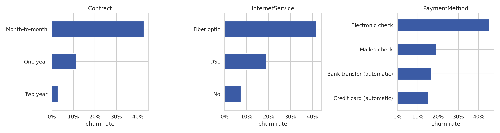
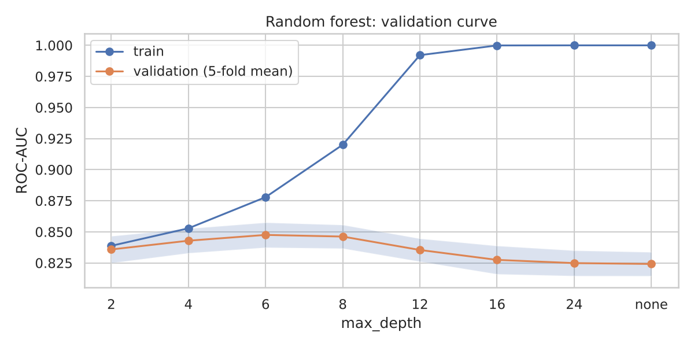
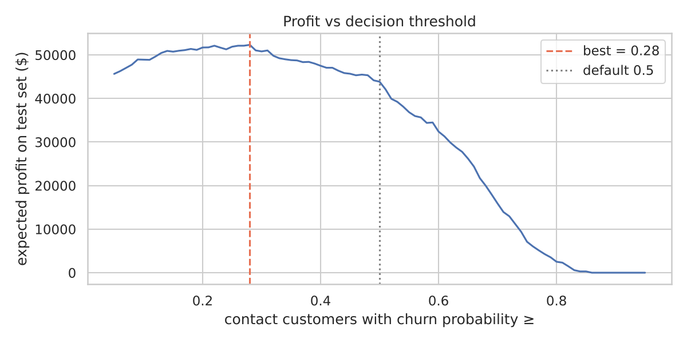
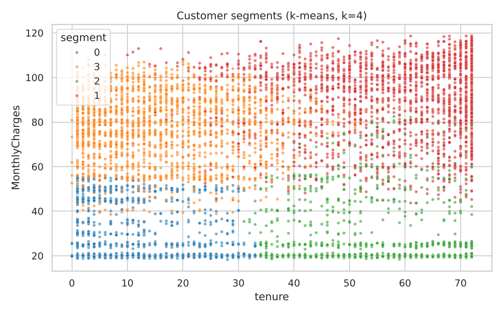

# Customer Churn Analysis — Telco

End-to-end data science project on the IBM Telco Customer Churn dataset (7,043 customers): SQL exploration,
cross-validated model comparison, overfitting diagnostics, model interpretation, a profit-based decision
threshold, and unsupervised customer segmentation.

**Full analysis:** [`notebooks/churn_analysis.ipynb`](notebooks/churn_analysis.ipynb)

## Key results

| | |
|---|---|
| Best model | Logistic regression (ties random forest and gradient boosting, smallest train/validation gap) |
| Test ROC-AUC | **0.84** |
| Test PR-AUC | **0.63** (random baseline: 0.27) |
| Top-decile lift | **2.8×** — the 10% highest-scored customers churn at 2.8× the average rate |
| Decision threshold | **0.28** instead of 0.5 under the stated campaign assumptions: +19% expected profit |
| Segments | 4 k-means segments with churn rates from **4%** to **47%** (churn not used for clustering) |

### What drives churn (SQL + model)

* Month-to-month contracts churn at **43%** vs **3%** for two-year contracts and account for most lost revenue.
* Churn is concentrated in the **first year** of tenure (48%).
* Electronic-check payers churn ~3× as often as customers on automatic payment.
* Fiber-optic customers **without tech support** churn at about twice the rate of those with it.



### Overfitting vs underfitting

Random forest validation curve: shallow trees underfit, trees deeper than ~8 levels memorise the training set
(train ROC-AUC → 1.0) while validation performance drops.



### From probabilities to a decision

With an illustrative retention offer ($50 per contact, 30% success, 12 months of revenue saved), contacting
customers above a 0.28 churn probability maximises expected profit. A sensitivity table in the notebook shows
how the best threshold moves as the assumptions change.



### Customer segments



## Methods

* **Cleaning:** `TotalCharges` is text and blank only for customers with `tenure = 0`; these are set to 0
  (they have not been billed), and the code checks this assumption.
* **SQL:** the cleaned table is loaded into SQLite; queries are in [`sql/eda_queries.sql`](sql/eda_queries.sql)
  and use standard SQL (they also run on MySQL/PostgreSQL).
* **Features:** one-hot encoding, scaling, plus two engineered features — number of add-on services and
  average monthly spend (`TotalCharges / tenure`).
* **Validation:** 80/20 stratified train/test split; stratified 5-fold CV on the training set; all
  preprocessing inside scikit-learn pipelines to avoid leakage; the test set is used once.
* **Metrics:** ROC-AUC, PR-AUC and F1 (classes are imbalanced, 27% churn); calibration curve; top-decile lift.
* **Interpretation:** logistic-regression coefficients and permutation importance.
* **Unsupervised:** k-means on standardised tenure, monthly charges and add-on count; k chosen with silhouette
  score and the elbow method.

## Project structure

```
data/                     raw CSV (see data/README.md for source)
sql/eda_queries.sql       exploratory SQL queries
src/churn/
    data.py               loading, cleaning, feature lists
    db.py                 SQLite database + named-query loader
    features.py           feature engineering and preprocessing pipeline
    models.py             candidate models, CV comparison, validation curve
    business.py           profit model and threshold selection
    segment.py            k-means segmentation
notebooks/churn_analysis.ipynb
reports/figures/          figures produced by the notebook
tests/                    pytest unit tests
```

## How to run

```bash
python -m venv .venv && source .venv/bin/activate   # Windows: .venv\Scripts\activate
pip install -r requirements.txt
pytest                                             # run the tests
jupyter notebook notebooks/churn_analysis.ipynb    # run the analysis
```

## Limitations

A single snapshot with no time dimension, so the model can't see behaviour changes before a customer leaves;
campaign economics are assumptions, not company data; all findings are correlational, not causal.
